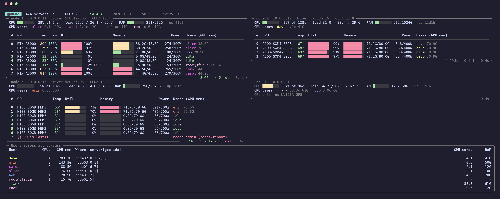

# gpuwho

[](https://github.com/htyvv/gpuwho/actions/workflows/ci.yml)

[](LICENSE)

**연구실 GPU 서버 전체를 위한 nvidia-smi. SSH만 있으면 됩니다.**

어느 서버의 몇 번 GPU를 누가, 얼마나 쓰고 있는지 터미널 하나에서 봅니다.
서버에는 아무것도 설치하지 않습니다. 작은 파이썬 에이전트를 SSH로 흘려보내서 NVML을 직접 읽습니다.

[English](README.md) | 한국어

<p align="center">
  
  <br>
  <sub>서버 4대, GPU 20장, 터미널 하나. 화면의 서버와 사용자는 가짜 데이터입니다 (<code>scripts/screenshot.py</code>).</sub>
</p>

```sh
pipx install git+https://github.com/htyvv/gpuwho
gpuwho add gpu1 10.0.0.11
gpuwho
```

## 보이는 것

- 모든 서버의 모든 GPU: 사용률, 메모리, 온도, 팬, 전력, 그리고 쓰는 중일 때는 인코더/디코더까지.
- GPU마다 누가 메모리를 얼마나 잡고 있는지. Docker로 돌린 작업은 `root@3f9c2a`처럼 컨테이너 ID로 나옵니다.
- 지금 비어 있는 GPU. 프로세스가 없고, 사용 메모리 1 GiB 미만, 사용률 5% 미만일 때만 idle로 칩니다. GPU에 붙어 있는 Xorg나 gnome-shell 같은 디스플레이 서버는 사용자로 세지 않습니다.
- 서버 전체를 합친 사용자별 표: GPU 몇 장, GPU 메모리, 어디서(`node01[0,1]`), CPU 코어, RAM.
- GPU 없는 CPU 서버도 부하, RAM, 많이 쓰는 사용자를 보여줍니다.
- PID, 사용자, GPU 메모리, CPU%, RAM, 실행 명령이 나오는 프로세스 표 (`-p` 또는 `p` 키).
- 버스에서 떨어진 GPU("GPU is lost")는 빨간 줄로 표시합니다. 관리자에게 연락할 때입니다.

## 설치

gpuwho를 실행할 컴퓨터에는 Python 3.9 이상(Linux 또는 macOS)과 서버로 가는 SSH만 있으면 됩니다.
서버 쪽은 Linux, NVIDIA 드라이버, 그리고 3.6 이상의 아무 `python3`면 충분합니다.

```sh
pipx install git+https://github.com/htyvv/gpuwho
# 또는
uv tool install git+https://github.com/htyvv/gpuwho
```

연구실 서버들이 NFS로 홈 디렉터리를 공유한다면 한 번만 설치하면 됩니다. 어느 서버에서든 `gpuwho`을 실행할 수 있고, 서버 목록도 홈에 있으니 같이 따라옵니다.

## 사용법

서버마다 한 번씩 등록합니다. 등록할 때 바로 접속해 보고, 되는 것을 확인한 뒤에 저장합니다.

```sh
gpuwho add gpu1 10.0.0.11                      # SSH 키나 ssh-agent 사용
gpuwho add gpu2 10.0.0.12 -u alice --password  # 비밀번호를 물어보고 저장 (파일 권한 0600)
gpuwho add dgx dgx.example.org -P 2222 --key ~/.ssh/id_lab
gpuwho add here local                          # 지금 이 컴퓨터, SSH 없이
```

그다음엔 `gpuwho`만 치면 됩니다. `p`로 프로세스 표를 켜고 끄고, `q`로 나갑니다.

```
gpuwho                 실시간 대시보드, 3초마다 갱신
gpuwho -i 1 -p         1초마다, 프로세스 표와 함께
gpuwho once            한 번 출력하고 종료 (스크립트, cron용)
gpuwho once --json     같은 내용을 JSON으로
gpuwho once gpu1 gpu2  일부 서버만
gpuwho test            모든 서버 접속 확인
gpuwho list            등록된 서버 목록
gpuwho remove gpu2
```

`gpuwho once --json`에는 대시보드가 아는 정보가 전부 들어 있어서, 빈 GPU 찾기 같은 건 한 줄이면 됩니다.

```sh
gpuwho once --json | jq -r 'to_entries[] | .key as $s | .value.gpus[]?
  | select(.invalid != true and .mem_used < 1024 and .util < 5) | "\($s) gpu\(.index)"'
```

## 동작 방식

- 서버마다 SSH 연결을 하나 열고([paramiko](https://www.paramiko.org/)), 거기서 [`probe.py`](gpuwho/probe.py)를 `python3 -c`로 띄웁니다. 스크립트는 압축된 채로 명령어 안에 실려 가기 때문에 서버 디스크에는 아무것도 남지 않습니다.
- 에이전트는 세션 동안 계속 살아 있습니다. 갱신할 때마다 줄바꿈 하나를 보내고 JSON 한 줄을 받습니다. 매번 SSH 핸드셰이크를 하거나 프로세스를 새로 띄우지 않습니다.
- GPU 정보는 `nvidia-smi`가 쓰는 라이브러리인 NVML을 `ctypes`로 직접 읽습니다. `nvidia-smi`를 실행하거나 그 출력을 파싱하지 않습니다.
- 프로세스 주인은 `/proc`에서, 컨테이너는 `/proc/PID/cgroup`에서 알아냅니다 (Docker, containerd, Podman, CRI-O).
- 사용자별 RAM은 RSS를 더한 값이 아니라, 커널이 그 사용자의 cgroup에 청구한 메모리(익명 + 공유 메모리)입니다. RSS를 더하면 fork된 DataLoader 워커들이 부모와 공유하는 페이지가 워커 수만큼 중복으로 더해집니다. 우리 서버 한 대에서는 실제 220 GB를 쓰는 사용자가 1.4 TB로 나왔습니다. cgroup 메모리 정보를 읽을 수 없는 서버에서는 RSS 합으로 돌아갑니다.
- 에이전트는 표준 라이브러리만 쓰고 Python 3.6부터 돌아갑니다. CI에서 gpuwho가 실제로 보내는 명령 그대로 3.6, 3.7, 3.8에서 확인합니다.
- 내 계정 권한으로 돌고 root가 필요 없습니다. SSH 세션이 끊기거나, 90초 동안 요청이 없거나, 6시간이 지나면 스스로 종료합니다.
- 프로세스 1,700개, GPU 8장인 서버에서 한 번 갱신에 CPU 약 70 ms를 씁니다. 기본 3초 간격이면 코어 하나의 2% 정도입니다.
- NVIDIA 드라이버가 멈추면 NVML 호출은 15초 뒤에 포기하고, 그 서버의 CPU와 RAM은 계속 보여줍니다.

## 왜 만들었나

우리 연구실에는 GPU 서버가 여러 대 있고 홈 디렉터리는 하나를 공유합니다. 빈 GPU를 찾으려면 서버마다 `ssh` 들어가서 `nvidia-smi`를 치고, PID 812345가 누구 건지 `ps`로 다시 찾아야 했습니다. gpuwho는 그 일을 모든 서버에 대해 3초마다, 창 하나에서 대신 해줍니다.

## 다른 도구와 비교

좋은 GPU 모니터는 이미 많습니다. 2026년 10월 기준으로 각 프로젝트의 README와 소스를 보고 정리한 차이입니다.

| | 여러 서버를 한 화면에 | 서버마다 필요한 것 | GPU 프로세스 주인 표시 | 화면 |
|---|---|---|---|---|
| **gpuwho** | 예 | `python3` (설치 없음) | 예, Docker 작업 포함 | 터미널 |
| [nvitop](https://github.com/XuehaiPan/nvitop) | 아니요, 한 대씩 (`ssh -t host nvitop`) | nvitop | 예 | 터미널 |
| [nvtop](https://github.com/Syllo/nvtop) | 아니요, 한 대씩 | nvtop | 예 | 터미널 |
| [gpustat](https://github.com/wookayin/gpustat) | 아니요, 한 대씩 | gpustat | 예 | 터미널 |
| [gpustat-web](https://github.com/wookayin/gpustat-web) | 예 | gpustat | 예 | 브라우저 |
| [all-smi](https://github.com/lablup/all-smi) | 예 | SSH 모드는 없음, 전체 정보는 `all-smi api` | SSH 모드에서는 안 됨 | 터미널 |
| [cluster-smi](https://github.com/PatWie/cluster-smi) | 예 | 노드 데몬 | 예 | 터미널 |
| [gpuview](https://github.com/fgaim/gpuview) | 예 | gpuview 서비스 | 일부 | 브라우저 |
| [DCGM exporter](https://github.com/NVIDIA/dcgm-exporter) + Grafana | 예 | exporter, Prometheus | Kubernetes 파드만 | 브라우저 |

이럴 땐 다른 도구가 낫습니다.

- 서버 한 대에서 프로세스를 죽이고, 트리로 보고, 지난 그래프를 보고 싶다면 **nvitop**.
- AMD, Intel, Apple 등 다른 가속기가 있다면 **nvtop**이나 **all-smi**. gpuwho는 NVIDIA 전용입니다.
- 노드가 아주 많고 NVLink 토폴로지, 기록, 알림이 필요하다면 **all-smi**.
- 기록, 알림, Kubernetes가 필요하다면 **DCGM exporter**와 Prometheus, Grafana 또는 Netdata. gpuwho는 아무것도 저장하지 않고 지금 상태만 보여줍니다.
- 터미널 대신 웹 페이지로 보고 싶다면 **gpustat-web**이나 **gpuview**.

## 자주 묻는 것

**AMD나 Intel GPU도 되나요?**
아니요, NVIDIA만 됩니다 (NVML을 씁니다). NVIDIA GPU가 없는 서버도 CPU, RAM, 사용자는 보여줍니다.

**`~/.ssh/config`를 읽나요?**
아직 안 읽습니다. `gpuwho add`에 실제 호스트와 `-u`, `-P`, `--key`를 넘겨 주세요. `ProxyJump`로 거쳐 가는 접속도 아직 안 됩니다.

**비밀번호를 저장해도 안전한가요?**
`~/.config/gpuwho/servers.json`에 평문으로 저장되고, gpuwho가 시작할 때마다 이 파일 권한을 0600으로 맞춥니다. 가능하면 SSH 키를 쓰세요. [SECURITY.md](SECURITY.md)에 자세히 있습니다.

**Windows에서 되나요?**
그대로는 안 되고, WSL 안에서는 잘 됩니다.

## 문제 해결

**`AuthenticationException: Authentication failed.`**
비밀번호가 틀렸거나, 키가 서버의 `authorized_keys`에 없습니다. `gpuwho add NAME HOST --password --force`로 다시 등록하세요.

**`RuntimeError: bash: line 1: exec: python3: not found`**
비대화형 셸의 PATH에 `python3`가 없습니다. 설치하거나, `~/.bashrc`가 비대화형 셸에서 일찍 return 하기 전에 PATH를 설정하도록 고치세요.

**`BadHostKeyException: Host key for server ... does not match`**
gpuwho가 처음 본 뒤로 서버의 호스트 키가 바뀌었습니다. 재설치처럼 이유를 안다면 `~/.config/gpuwho/known_hosts`에서 그 줄을 지우세요.

**사용자 칸에 `?`가 나와요**
그 서버의 `/proc`가 `hidepid` 옵션으로 마운트되어 있어서 다른 사람의 프로세스가 보이지 않는 겁니다.

**`process info N/A`**
NVML이 그 GPU의 프로세스 목록을 줄 수 없다고 답한 경우입니다. 사용률과 메모리는 그대로 나옵니다.

**사용자 RAM이 `ps`나 `htop`에서 더한 값과 달라요**
gpuwho는 커널이 그 사용자의 cgroup에 청구한 메모리를 보여줍니다. 그 사용자가 `/dev/shm`에 만든 파일은 포함되고 페이지 캐시는 빠집니다. 프로세스 표의 RAM은 지금처럼 프로세스별 RSS입니다.

## 개발

```sh
git clone https://github.com/htyvv/gpuwho && cd gpuwho
python -m pip install -e . pytest ruff
python -m pytest
ruff check .
```

테스트는 [`tests/fixtures/cluster.json`](tests/fixtures/cluster.json)의 가짜 클러스터와, 내 컴퓨터에서 실제로 띄운 에이전트로 돌아갑니다. `python scripts/screenshot.py docs/screenshot.png`는 같은 데이터로 스크린샷을 다시 그립니다 (Pillow 필요).

## 감사의 말

NVML 처리 방식(프로세스 API 폴백, 메모리 v2, 사라진 GPU 처리)은 [gpustat](https://github.com/wookayin/gpustat)을 참고했습니다. 터미널 UI는 [Rich](https://github.com/Textualize/rich)로 만들었습니다.

## 라이선스

[MIT](LICENSE)
