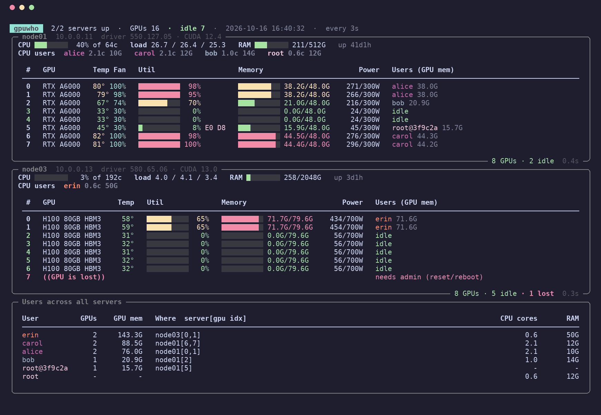

# gpuwho

[](https://github.com/htyvv/gpuwho/actions/workflows/ci.yml)

[](LICENSE)

**实验室所有 GPU 服务器的 nvidia-smi：一个终端看清每张卡谁在用、哪张空着。**

走 SSH，服务器上什么都不用装：gpuwho 通过 SSH 发过去一个只用标准库的 Python 小脚本，直接读 NVML。

[English](README.md) | 简体中文 | [한국어](README.ko.md)

<p align="center">
  
  <br>
  <sub>画面里的服务器和用户来自 <code>gpuwho demo</code>，都是编的：node01 上一个任务跑完，node03 上又开了一个。</sub>
</p>

```sh
pipx install git+https://github.com/htyvv/gpuwho
gpuwho demo                   # 先试试，不需要服务器
gpuwho add gpu1 10.0.0.11     # 再加上自己的
gpuwho
```

## 以前 / 现在

| 以前 | 现在 |
|---|---|
| 挨个 `ssh` 上去跑 `nvidia-smi` | 所有服务器、所有卡，一屏看完，每 3 秒刷新 |
| `nvidia-smi` 只给 PID，再拿去 `ps` 里查是谁 | 直接显示用户名和占了多少显存 |
| Docker 里的任务全是 root，不知道是谁的 | 显示为 `root@3f9c2a`（容器 ID），能对上是哪个容器 |
| 在群里喊一声"谁在用 3 号卡" | `gpuwho free` 列出空卡，脚本里直接用 |

## 能看到什么

- 每台服务器每张卡的利用率、显存、温度、风扇、功耗；在用编解码器时也会显示。
- 每张卡是谁在用、占了多少显存。Docker 里的任务显示为容器 ID，比如 `root@3f9c2a`。
- 哪些卡现在空着：没有进程、显存占用 < 1 GiB、利用率 < 5% 才算空闲。只挂着 Xorg、gnome-shell 的卡也算空。
- 按人汇总：每个人在所有服务器上占了几张卡、多少显存、在哪几台（如 `node01[0,1]`），以及 CPU 核数和内存。
- 两个任务挤在同一张卡上时，看得出谁在真正计算（SM%），谁只是占着显存。
- 纯 CPU 的机器也能看负载、内存和占用最多的人。
- 掉卡（"GPU is lost"）会标红，该找管理员了。MIG 的卡按实例读取。

终端够宽时服务器并排显示；服务器多到放不下时自动切成每台一行（按 `c` 切换），还放不下就滚动。

<p align="center">
  
</p>

## 安装

只装在你"看"的那台机器上（笔记本，或任意一台服务器上你自己的账号）：Python 3.9+，Linux 或 macOS（Windows 用 WSL）。
服务器那边只需要 Linux、NVIDIA 驱动和 3.6 以上的任意 `python3`。不需要 root，不用找管理员。

```sh
pipx install git+https://github.com/htyvv/gpuwho
# 或者
uv tool install git+https://github.com/htyvv/gpuwho
```

访问 GitHub 慢的话：在 [Releases](https://github.com/htyvv/gpuwho/releases) 页面下载 `.whl` 文件，然后 `pip install gpuwho-*.whl`（依赖 rich 和 paramiko 会从你配置的 PyPI 镜像下载）。

组里服务器共享 home（NFS）的话，装一次就行，哪台节点都能用，服务器列表也在 home 里。

## 用法

每台服务器加一次。gpuwho 会先连一下确认能用，再保存。

```sh
gpuwho add gpu1 10.0.0.11                 # 用你的 SSH 密钥或 ssh-agent
gpuwho add gpu2 alice@10.0.0.12 --password # 输入密码并保存（文件权限 0600）
gpuwho add dgx dgx.example.org:2222 --key ~/.ssh/id_lab
gpuwho add lab-a100                       # ~/.ssh/config 里的 Host，跳板机（ProxyJump）也照用
gpuwho add here local                     # 本机，不走 SSH
```

没写的（用户名、端口、密钥、跳板机）都按 `ssh` 的规则从 `~/.ssh/config` 里取。

然后运行 `gpuwho`：

| 按键 | |
|---|---|
| `q` | 退出 |
| `p` | 进程表（PID、用户、显存、SM%、CPU%、内存、命令行） |
| `c` | 紧凑视图，每台服务器一行 |
| `j` `k` `↑` `↓` `PgUp` `PgDn` `g` `G` | 滚动 |
| `r` | 立刻重连失败的服务器 |
| `space` | 暂停 |
| `?` | 帮助 |

```
gpuwho                       实时面板，每 3 秒刷新
gpuwho -i 1 -p               每秒刷新，带进程表
gpuwho once                  打印一次就退出（在 watch、cron、管道里运行也是这样）
gpuwho once --json           同上，JSON 格式
gpuwho test                  检查所有连接，有一台失败就返回 1
gpuwho list | remove gpu2
```

### 找空卡

```sh
gpuwho free                          # 所有空闲的卡，剩余显存多的在前
gpuwho free --min-free 40            # 剩余显存 ≥ 40 GiB 且利用率 < 50% 的卡
CUDA_VISIBLE_DEVICES=$(gpuwho free gpu1 -n 2 --ids) python train.py
```

卡不够时 `gpuwho free` 返回 1，可以直接写进脚本或者排队启动任务的地方。

## 原理

- 每台服务器开一个 SSH 连接（[paramiko](https://www.paramiko.org/)），用 `python3 -c` 启动 [`probe.py`](gpuwho/probe.py)。脚本压缩后放在命令里传过去，不落盘。
- 这个小进程整个会话期间一直在。每次刷新发一个换行，收回一行 JSON，不用每次重新握手、重新起进程。
- 显卡数据通过 `ctypes` 直接读 NVML（`nvidia-smi` 背后的库），不调用也不解析 `nvidia-smi`。
- 进程属于谁从 `/proc` 读，容器从 `/proc/PID/cgroup` 读（Docker、containerd、Podman、CRI-O）。
- 每个人的内存是内核记在他 cgroup 上的量（匿名内存 + 共享内存），不是把 RSS 加起来。直接加 RSS 的话，DataLoader fork 出来的 worker 和父进程共享的页会按 worker 数重复计算：我们一台服务器上，实际占 220 GB 的人被算成了 1.4 TB。
- 服务器上的脚本只用标准库，Python 3.6 起就能跑。CI 里用 gpuwho 实际发送的命令在 3.6、3.7、3.8 上都测过。
- 以你自己的身份运行，不需要 root。SSH 断开、90 秒没有请求或者运行满 6 小时会自己退出。
- 在 1,700 个进程、8 张卡的服务器上，每次刷新大约 45 ms CPU，默认 3 秒间隔下约占一个核的 1.5%。`/proc` 每 5 次才全量扫一遍，中间只看有用的进程。
- 连不上的服务器按 2、4、8 …… 最多 60 秒的间隔重试。密码错误或主机密钥变了不会自动重试，等你按 `r`，不会触发服务器的 fail2ban。

## 为什么写这个

我们实验室有好几台 GPU 服务器，共享一个 home。想找张空卡，就得挨个 `ssh` 上去跑 `nvidia-smi`，再拿 PID 812345 去 `ps` 里查是谁。gpuwho 把这件事替你做了：所有服务器，每 3 秒一次，一个窗口。

## 和其他工具比

好用的 GPU 监控工具已经不少。下面是 2026 年 10 月看了各项目 README 和源码后整理的区别。

| | 多台服务器一屏 | 每台服务器上需要 | 显示 GPU 进程属于谁 | 界面 |
|---|---|---|---|---|
| **gpuwho** | 是 | `python3`（不用安装） | 是，包括 Docker 任务 | 终端 |
| [nvitop](https://github.com/XuehaiPan/nvitop) | 否，一次一台（`ssh -t host nvitop`） | nvitop | 是 | 终端 |
| [nvtop](https://github.com/Syllo/nvtop) | 否，一次一台 | nvtop | 是 | 终端 |
| [gpustat](https://github.com/wookayin/gpustat) | 否，一次一台 | gpustat | 是 | 终端 |
| [svtop](https://pypi.org/project/svtop/) | 是 | 不需要（运行 `nvidia-smi`） | 是 | 终端 |
| [gpustat-web](https://github.com/wookayin/gpustat-web) | 是 | gpustat | 是 | 浏览器 |
| [all-smi](https://github.com/lablup/all-smi) | 是 | SSH 模式不需要，完整数据要 `all-smi api` | SSH 模式下不显示 | 终端 |
| [cluster-smi](https://github.com/PatWie/cluster-smi) | 是 | 节点守护进程 | 是 | 终端 |
| [gpuview](https://github.com/fgaim/gpuview) | 是 | gpuview 服务 | 部分 | 浏览器 |
| [DCGM exporter](https://github.com/NVIDIA/dcgm-exporter) + Grafana | 是 | exporter、Prometheus | 只有 Kubernetes pod | 浏览器 |

这些情况用别的更合适：

- 只在一台机器上干活，想直接操作：杀进程、看进程树、翻历史曲线，用 **nvitop**。
- 服务器上没有 `python3`，或者想在监控旁边传文件，用 **svtop**。
- 有 AMD、Intel、Apple 或其他加速卡，用 **nvtop** 或 **all-smi**。gpuwho 只支持 NVIDIA。
- 节点特别多，要 NVLink 拓扑、录制或告警，用 **all-smi**。
- 要历史数据、告警或 Kubernetes，用 **DCGM exporter** 配 Prometheus、Grafana，或者 Netdata。gpuwho 什么都不存，只看当下。
- 想要网页或者桌面状态栏，用 **gpustat-web**、**gpuview** 或 [Multiple-smi](https://github.com/ClementPinard/Multiple-smi)。

如果 gpuwho 帮你少 ssh 了几次，点个 star 能让更多实验室找到它。

## 常见问题

**支持 AMD 或 Intel 显卡吗？**
不支持，只支持 NVIDIA（读的是 NVML）。没有 NVIDIA 卡的服务器照样显示 CPU、内存和用户。

**会读 `~/.ssh/config` 吗？跳板机呢？**
会。gpuwho 用 `ssh -G` 取最终配置，所以 `Include`、`Match`、`ProxyJump`、`ProxyCommand` 都能用。跳板机由你本机的 `ssh` 用密钥或 agent 连接，保存的密码只发给最终那台服务器。

**保存密码安全吗？**
密码以明文存在 `~/.config/gpuwho/servers.json`，gpuwho 每次启动都会把权限改回 0600。能用密钥就用密钥。详见 [SECURITY.md](SECURITY.md)。

**对服务器有多大负担？**
默认间隔下每台服务器约占一个核的 1.5%，脚本本身约 30 MB 内存。见上面的[原理](#原理)。

**Windows 能用吗？**
不能直接用，在 WSL 里没问题。

## 出问题时

**`auth failed: Authentication failed.`**
密码错了，或者你的密钥不在服务器的 `authorized_keys` 里。用 `gpuwho add NAME HOST --password --force` 重新添加，再按 `r`。

**`RuntimeError: bash: line 1: exec: python3: not found`**
非交互 shell 的 PATH 里找不到 `python3`。装一个，或者让 `~/.bashrc` 在非交互 shell 提前 return 之前就设置好 PATH。

**`host key changed for ...`**
服务器的主机密钥和第一次连接时不一样了。如果知道原因（比如重装系统），运行 `ssh-keygen -R HOST`，再删掉 `~/.config/gpuwho/known_hosts` 里那一行。

**用户那一栏显示 `? (hidden)` 或 `? (gone)`**
`hidden`：那台服务器的 `/proc` 用了 `hidepid` 挂载，看不到别人的进程。`gone`：进程已经退出但驱动还占着显存，一般是被杀掉的任务留下的 DataLoader worker。

**`process info N/A`**
NVML 说这张卡列不出进程。利用率和显存照常显示。

**某人的内存和 `ps`、`htop` 加起来的不一样**
gpuwho 显示的是内核记在这个用户 cgroup 上的内存，包括他放在 `/dev/shm` 里的文件，不包括页缓存。进程表里的内存还是每个进程的 RSS。

## 开发

```sh
git clone https://github.com/htyvv/gpuwho && cd gpuwho
python -m pip install -e . pytest ruff
python -m pytest
ruff check .
```

测试用的是 [`gpuwho/demo.json`](gpuwho/demo.json) 里编出来的集群，外加在你本机真正跑起来的脚本。`python scripts/screenshot.py docs/screenshot.png` 和 `python scripts/screenshot.py docs/demo.gif --gif --width 140 --servers node01,node03 --size 20` 用同一份数据重画图片（需要 Pillow）。

## 致谢

NVML 的处理方式（进程 API 的版本回退、memory v2、掉卡、按进程的利用率）参考了 [gpustat](https://github.com/wookayin/gpustat) 和 [nvitop](https://github.com/XuehaiPan/nvitop)。终端界面用的是 [Rich](https://github.com/Textualize/rich)。

## 许可证

[MIT](LICENSE)
